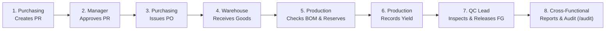

# Manufacturing Digital Operations System (MOM / MES)

> An enterprise-grade Manufacturing Operations Management (MOM) platform engineered to digitize factory workflows from procurement through inventory, production, quality control, operational insights, and immutable audit traceability.

[](https://github.com)
[](https://github.com)
[](https://github.com)
[](https://www.typescriptlang.org/)
[](https://react.dev/)
[](https://tailwindcss.com/)
[](https://expressjs.com/)

---

## 📌 Executive Summary

Traditional manufacturing environments frequently suffer from siloed spreadsheets, stockouts caused by unreserved materials, duplicate inspections, and fragmented compliance paper trails. 

The **Manufacturing Digital Operations System** provides a unified, precision-engineered digital operations hub enforcing:
1. **Strict Segregation of Duties (SoD)** across 6 enterprise roles.
2. **ACID-Compliant Inventory Integrity** preventing negative stock and phantom allocations.
3. **End-to-End Lot & Batch Genealogy** connecting supplier purchase orders to finished goods quality release.
4. **Immutable Audit Trails** logging actor attribution on every state transition.
5. **Operational Reporting & Analytics** with live SQL aggregations, yield rates, defect Pareto analysis, and sanitized CSV exports.
6. **Observability & Production Readiness** with separated liveness/readiness probes, structured logging with credential redaction, and graceful shutdown lifecycle management.

---

## 👥 Demo Accounts & Role-Based Access Control (RBAC)

The login screen features **one-click demo presets** to easily inspect the user experience for each role:

| Role | Demo Credentials | Primary Responsibilities | Strict Permissions & Segregation of Duties |
| :--- | :--- | :--- | :--- |
| **Admin** | `admin@mfg.com` / `admin123` | System Administrator | Full superuser access across all operational modules, reporting, and audit trails. |
| **Manager** | `manager@mfg.com` / `demo123` | Plant / Operations Supervisor | Purchase Request approval, operational overrides, and plant-wide audit reviews. |
| **Purchasing** | `purchasing@mfg.com` / `demo123` | Sourcing Specialist | Requisition materials (PR), issue formal Purchase Orders (PO), manage supplier catalogs. *Forbidden from approving own PRs or recording physical Goods Receipt.* |
| **Warehouse** | `warehouse@mfg.com` / `demo123` | Warehouse Keeper | Inbound Goods Receipt (GR), cycle count adjustments, real-time stock monitoring. *Forbidden from issuing POs or approving PRs.* |
| **Production** | `production@mfg.com` / `demo123` | Shop Floor Operator | Schedule Production Orders, verify BOM material availability, reserve stock, and record completion yield. *Forbidden from QC inspection of own output.* |
| **Quality Control** | `qc@mfg.com` / `demo123` | Quality Inspector | Independent verification of completed production, pass/fail grading, defect classification, and finished goods release. |

> 📖 **Complete Walkthrough**: See [`docs/demo-guide.md`](docs/demo-guide.md) for a step-by-step 5-minute interactive evaluation guide.

---

## 🔄 End-to-End Operational Lifecycle Walkthrough



### Step 1: Requisition Materials (Purchasing)
- Log in as `purchasing@mfg.com`.
- Go to **Procurement** &rarr; Click **"New Purchase Request"**.
- Add material `High-Tensile Cold-Rolled Steel Sheet` with quantity `50 kg`.
- Status is created as **Pending**. Self-approval is blocked on backend and frontend.

### Step 2: Management Approval (Manager)
- Log in as `manager@mfg.com`.
- Go to **Procurement** &rarr; Notice the pending PR.
- Click **"Approve"**. Status transitions to **Approved**.

### Step 3: Issue Purchase Order (Purchasing)
- Log in as `purchasing@mfg.com`.
- In the PR table, click **"Create PO"** on the approved row.
- Select supplier `Nippon Steel Partner Supplies`, enter unit price `$12.50`, and submit.
- The Purchase Order is issued with a unique PO ID and item lines.

### Step 4: Physical Inbound Receiving (Warehouse)
- Log in as `warehouse@mfg.com`.
- Go to **Procurement** &rarr; **Purchase Orders** tab.
- Click **"Receive Goods"** on the issued PO.
- Verify delivery quantity (`50 kg`) and confirm receipt.
- Stock is automatically credited to the **Inventory Management** ledger.

### Step 5: Schedule Production & Reserve BOM Materials (Production)
- Log in as `production@mfg.com`.
- Go to **Production Orders** &rarr; Click **"New Production Order"**.
- Select finished good `Modular Industrial Automation Enclosure`, planned qty `5 units`, requiring `20 kg` of steel.
- Click **"Check Stock"** &rarr; System verifies `20 kg required <= available stock` (:white_check_mark: Sufficient).
- Click **"Reserve Materials"** &rarr; Stock is atomically transferred from `available_stock` to `reserved_stock`. Status becomes **Ready**.

### Step 6: Record Factory Output (Production)
- On the Ready production order, click **"Record Production"**.
- Enter actual yield `5 units`.
- Reserved materials are consumed; order status becomes **Completed**, yielding a production record.

### Step 7: Independent Quality Verification (Quality Control)
- Log in as `qc@mfg.com`.
- Go to **Quality Control** &rarr; **Pending Inspections** tab.
- Click **"Inspect"** on the completed batch.
- Enter `4 Pass` and `1 Fail`. Select defect reason `"Surface scratch beyond tolerance"`.
- Passed units are formally released into finished goods records; defects are recorded for traceability.

### Step 8: Multi-Tier Genealogy & Operational Insights (Any User)
- Navigate to **Reports & Insights** (`/reports`): View yield rate, defect Pareto distributions, supplier spend, and export sanitized CSV reports.
- Navigate to **Audit & Traceability** (`/audit`): Inspect actor logs and the complete 5-stage genealogy tree linking PO &rarr; GR &rarr; BOM consumption &rarr; production yield &rarr; QC signoff.

---

## 🛠️ Architecture & Technology Stack

```text
manufacturing-digital-operations/
├── apps/
│   ├── backend/               # Node.js + Express REST API (TypeScript)
│   │   ├── db/                # Knex schema migrations & realistic seed scripts
│   │   ├── src/
│   │   │   ├── config/        # Environment validation & safe masked diagnostics
│   │   │   ├── controllers/   # Request orchestration & HTTP status mapping
│   │   │   ├── middleware/    # JWT authentication, RBAC, request correlation, Zod
│   │   │   ├── routes/        # RESTful API route declarations & health probes
│   │   │   ├── schemas/       # Zod boundary validation schemas
│   │   │   ├── services/      # Business logic & ACID transaction management
│   │   │   ├── utils/         # Structured logger with automatic credential redaction
│   │   │   └── *.test.ts      # 20 Jest test suites (252 unit & integration tests)
│   │   └── package.json
│   │
│   └── frontend/              # Single Page Application (React 19 + Vite)
│       ├── src/
│       │   ├── api/           # Axios client with correlation ID & network handling
│       │   ├── components/    # Industrial precision UI component library
│       │   ├── pages/         # Dashboard, Materials, Inventory, Procurement,
│       │   │                  # Production, Quality Control, Reports, Audit Trail, Login
│       │   └── store/         # Zustand state management
│       └── package.json
└── package.json               # NPM Workspaces configuration
```

- **Frontend**: React 19, Vite, Tailwind CSS v4, Zustand, Axios, Lucide Icons.
- **Backend**: Node.js (18+ / 20+), Express 4.x, TypeScript, Knex.js, Zod, Jest, Supertest, Bcrypt, JWT.
- **Database**: PostgreSQL (production/development) / SQLite (flexible local fallback).

---

## 🚀 Local Quickstart Guide

### 1. Prerequisites
- **Node.js**: v18.x or v20.x+
- **NPM**: v9.x+

### 2. Installation
```bash
git clone https://github.com/your-username/manufacturing-digital-operations.git
cd manufacturing-digital-operations
npm install
```

### 3. Environment Setup
```bash
# Copy backend environment template
cp apps/backend/.env.example apps/backend/.env
```

### 4. Database Setup & Realistic Seed Data
```bash
# Run schema migrations
npm run migrate --workspace=backend

# Seed demo users (6 roles) and active operational pipeline data
npm run seed

# (Optional) Full clean reset and re-seed at any time:
npm run seed:reset
```

### 5. Launch Development Servers
```bash
npm run dev
```
- **Frontend UI**: [http://localhost:5173](http://localhost:5173)
- **Backend API**: [http://localhost:3001](http://localhost:3001)

---

## 🧪 Verification & Quality Gates

The repository maintains **20 automated test suites** covering validation, security boundaries, race conditions, reporting, observability, and complete workflows:

```bash
# Run full automated test suite (252 tests, 100% passing)
npm test

# Run backend test suite with coverage report (90% lines covered)
npm run test:coverage

# Verify TypeScript compilation across monorepo (0 errors)
npm run typecheck

# Run linter across workspaces (0 errors, 0 warnings)
npm run lint

# Build production bundles
npm run build
```

### Test Coverage Highlights:
- `workflow.e2e.test.ts`: Complete end-to-end integration (PR &rarr; PO &rarr; GR &rarr; ProdO &rarr; QC &rarr; FG).
- `inventory.integrity.test.ts`: Over-receipt guards, atomic reservations, stock release on cancellation.
- `rbac.authorization.test.ts`: 32 permission tests verifying HTTP 401/403 across all 6 roles.
- `audit.traceability.test.ts`: Actor attribution, stock ledger, multi-tier lot genealogy.
- `reports.test.ts`: 17 tests verifying KPI SQL aggregations, date validations, zero-division defense, and CSV formula injection sanitization.
- `observability.test.ts`: 23 tests verifying liveness/readiness probes, request correlation, credential redaction, and graceful shutdown.
- `security.reliability.test.ts`: DoS payload size limits (1MB), CORS policy, SoD self-approval prevention.

---

## 📚 Technical Documentation Inventory

- [`docs/demo-guide.md`](docs/demo-guide.md) — 5-minute interactive walkthrough and evaluator instructions.
- [`docs/production-readiness.md`](docs/production-readiness.md) — Health probes, structured logging, request correlation, and operational troubleshooting runbook.
- [`docs/operational-reporting.md`](docs/operational-reporting.md) — Reporting API contracts, KPI formulas, and CSV sanitization rules.
- [`docs/testing-strategy.md`](docs/testing-strategy.md) — Testing pyramid, test suite inventory, and CI/CD quality gates.
- [`docs/security-reliability-audit.md`](docs/security-reliability-audit.md) — Security controls, validation invariants, and threat mitigations.
- [`docs/architecture.md`](docs/architecture.md) — Monolith architecture, transaction boundaries, and state machines.
- [`docs/business-process.md`](docs/business-process.md) — Formal business workflows and transition rules.
- [`docs/erd.md`](docs/erd.md) — Entity-relationship diagrams and schema documentation.

---

## ⚖️ Panasonic Boundary & Portfolio Context

*This project is an independent portfolio piece developed for exploring enterprise digital operations and manufacturing software engineering. It is not affiliated with, nor does it use proprietary systems, internal APIs, or confidential data from Panasonic or any other corporation.*
