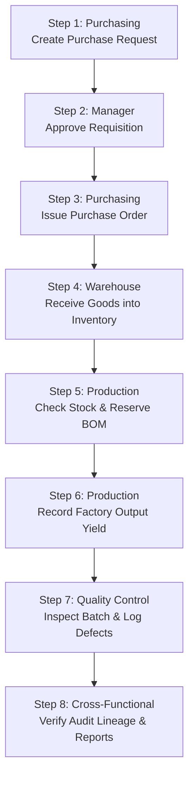

# Manufacturing Digital Operations System: Evaluator & Demo Guide

## 1. Executive Summary & Purpose

The **Manufacturing Digital Operations System** is an enterprise portfolio application demonstrating practical IT capabilities in a discrete manufacturing operations environment. 

The system implements the core operational lifecycle:
1. **Material Sourcing & Requisitions** (Procurement)
2. **Approval Governance & Segregation of Duties** (Management)
3. **Inbound Receiving & Stock Movements** (Warehouse)
4. **Work Order Execution & Bill of Materials (BOM) Allocation** (Production)
5. **Quality Inspections & Defect Tracking** (Quality Control)
6. **Lot & Batch Genealogy & Immutable Audit Trails** (Compliance)
7. **Operational Reporting & Manufacturing Insights** (Analytics)

> [!NOTE]
> **Panasonic Boundary & Portfolio Context**: This is an independent portfolio project exploring manufacturing software engineering and enterprise operations management. It is not affiliated with, nor does it use proprietary systems, internal APIs, or confidential data from Panasonic or any other corporation.

---

## 2. Demo Accounts & RBAC Matrix

The system enforces server-side Role-Based Access Control (RBAC) across 6 specialized operational roles. On the login screen, clicking any **Quick Fill Demo Role** button populates the credentials immediately.

| Role | Demo Credentials | Primary Function | Server-Side Segregation of Duties (SoD) Rules |
| :--- | :--- | :--- | :--- |
| **Admin** | `admin@mfg.com` / `admin123` | System Administrator | Unrestricted superuser access across all modules, configuration, and audit trails. |
| **Manager** | `manager@mfg.com` / `demo123` | Plant / Operations Supervisor | Requisition approvals, operational overrides, and plant-wide audit review. *Cannot issue formal POs or perform receiving.* |
| **Purchasing** | `purchasing@mfg.com` / `demo123` | Sourcing Specialist | Create Purchase Requests (PR), issue Purchase Orders (PO), manage supplier catalogs. *Forbidden from approving own PRs or recording physical Goods Receipt.* |
| **Warehouse** | `warehouse@mfg.com` / `demo123` | Warehouse Keeper | Inbound Goods Receipt (GR), cycle count adjustments, real-time stock monitoring. *Forbidden from issuing POs or approving PRs.* |
| **Production** | `production@mfg.com` / `demo123` | Shop Floor Operator | Schedule Production Orders, verify BOM stock availability, reserve inventory, record output yield. *Forbidden from performing QC on own output.* |
| **QC** | `qc@mfg.com` / `demo123` | Quality Inspector | Independent verification of completed production, pass/fail grading, defect categorization, finished goods release. |

---

## 3. End-to-End Walkthrough (5-Minute Interactive Demo)

Follow these steps in sequence to experience the complete manufacturing loop:



### Step 1: Material Requisition
- **Actor / Role**: `purchasing@mfg.com` (Purchasing Staff)
- **Navigation**: `/procurement` &rarr; Click **"New Purchase Request"**
- **Action**: Select material `High-Tensile Cold-Rolled Steel Sheet`, enter quantity `50 kg`, click submit.
- **Expected Outcome**: A new Purchase Request is created with status **`Pending`**.
- **RBAC Check**: Notice the PR table has no "Approve" button for Purchasing (self-approval is blocked on both frontend and backend).

### Step 2: Management Approval
- **Actor / Role**: `manager@mfg.com` (Plant Manager)
- **Navigation**: `/procurement`
- **Action**: Locate the pending PR created in Step 1, click **"Approve"**.
- **Expected Outcome**: PR status transitions from `Pending` to **`Approved`**. An audit record is logged with the manager's ID.

### Step 3: Purchase Order Issuance
- **Actor / Role**: `purchasing@mfg.com` (Purchasing Staff)
- **Navigation**: `/procurement`
- **Action**: Locate the approved PR, click **"Create PO"**. Select supplier `Nippon Steel Partner Supplies`, enter unit price `$12.50`, and submit.
- **Expected Outcome**: Purchase Order is generated with status **`Issued`** under the **Purchase Orders** tab.

### Step 4: Physical Inbound Receiving
- **Actor / Role**: `warehouse@mfg.com` (Warehouse Staff)
- **Navigation**: `/procurement` &rarr; **Purchase Orders** tab
- **Action**: Locate the issued PO, click **"Receive Goods"**. Confirm receiving quantity (`50 kg`).
- **Expected Outcome**: 
  - PO status updates to **`Completed`**.
  - A Goods Receipt record is created.
  - Stock in `/inventory` increases immediately by `50 kg` via an atomic `Receipt` transaction.

### Step 5: Production Order Scheduling & BOM Reservation
- **Actor / Role**: `production@mfg.com` (Production Staff)
- **Navigation**: `/production` &rarr; Click **"New Production Order"**
- **Action**: 
  1. Select product `Modular Industrial Automation Enclosure`, planned qty `5 units` (requires `20 kg` of steel).
  2. Click **"Check Stock"**: The system verifies `20 kg required <= available stock` (shows green "Sufficient" badge).
  3. Click **"Reserve Materials"**: Stock is atomically moved from `available_stock` to `reserved_stock`.
- **Expected Outcome**: Production order status transitions to **`Ready`**.

### Step 6: Factory Output Recording
- **Actor / Role**: `production@mfg.com` (Production Staff)
- **Navigation**: `/production`
- **Action**: Locate the Ready production order, click **"Record Production"**. Enter actual output `5 units`.
- **Expected Outcome**:
  - Reserved raw materials are deducted from inventory as `Consumption`.
  - Production order status becomes **`Completed`**.
  - A production record is created and queued for Quality Control inspection.

### Step 7: Independent Quality Verification
- **Actor / Role**: `qc@mfg.com` (Quality Control)
- **Navigation**: `/quality` &rarr; **Pending Inspections** tab
- **Action**: Locate the completed batch, click **"Inspect"**. Enter `4 Pass` and `1 Fail`. Select defect reason `"Surface scratch beyond tolerance"`.
- **Expected Outcome**:
  - Inspection record is saved.
  - Defect record is created.
  - 4 units of finished product are released to `finished_goods_records`.
  - The defect appears immediately in Dashboard critical alerts.

### Step 8: Genealogy & Operational Insights
- **Actor / Role**: Any role (e.g. `admin@mfg.com`)
- **Navigation**:
  - **Audit & Traceability** (`/audit`): Select the completed Production Order to view the interactive 5-stage genealogy tree connecting supplier PO &rarr; warehouse receipt &rarr; BOM consumption &rarr; production yield &rarr; QC signoff.
  - **Reports & Insights** (`/reports`): View yield rate, defect distribution, procurement spend, and export sanitized CSV reports.

---

## 4. Resetting & Seeding Demo Data

The database includes deterministic seeds covering master data, realistic suppliers, material thresholds, and sample pipeline states:

```bash
# Clean reset and re-seed all tables:
npm run seed:reset

# Or run seeds on an existing schema:
npm run seed
```

### What the Seed Script Populates:
1. **6 User Accounts** with hashed passwords matching the role matrix.
2. **4 Realistic Industrial Suppliers** (e.g. Nippon Steel Partner Supplies, Sumitomo Electric).
3. **5 Raw Materials** with safety thresholds (including `MAT-SLN-004` configured below threshold to trigger Low Stock alerts).
4. **3 Finished Products** with bill-of-materials definitions.
5. **Sample Active Pipeline**:
   - 1 Pending PR (ready for Manager to approve).
   - 1 Approved PR (ready for Purchasing to issue PO).
   - 1 Issued PO (ready for Warehouse to receive).
   - 1 Planned Work Order (ready for Production to reserve).
   - 1 Completed Work Order (ready for QC to inspect).
   - 1 Inspected Work Order with defect history for dashboard analytics.

---

## 5. Verification Commands Reference

```bash
# Run 20 backend test suites (252 unit & integration tests)
npm test

# Run backend test suite with code coverage (90% lines covered)
npm run test:coverage

# Run TypeScript compilation check across workspaces
npm run typecheck

# Run linter across workspaces
npm run lint

# Build production bundle (backend tsc + frontend vite build)
npm run build
```
