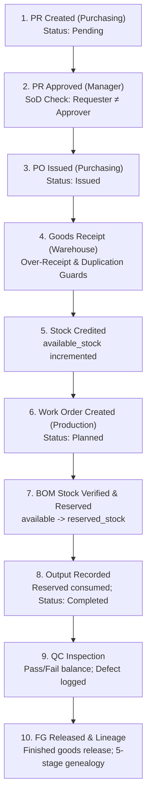

# Final Portfolio Audit & Release Readiness Assessment

## 1. Executive Verdict

### **Verdict: READY TO PRESENT**

The **Manufacturing Digital Operations System** has successfully passed a comprehensive, evidence-based audit. All core discrete manufacturing operational workflows, server-side authorization gates, transaction integrity constraints, reporting aggregations, observability probes, and demo onboarding experiences are verified.

| Audit Dimension | Status | Key Evidence |
| :--- | :--- | :--- |
| **Business Workflows** | :white_check_mark: Verified | Full end-to-end loop (PR &rarr; PO &rarr; GR &rarr; Inventory &rarr; MO &rarr; BOM &rarr; QC &rarr; FG &rarr; Audit) verified in `workflow.e2e.test.ts`. |
| **Segregation of Duties (SoD)** | :white_check_mark: Verified | Requesters blocked from approving own PRs; warehouse staff blocked from issuing POs; production staff blocked from QC inspection. |
| **Data & Transaction Integrity** | :white_check_mark: Verified | Atomic Knex transactions; over-receipt guards; negative stock checks; zero-division safe calculations. |
| **Security & Hardening** | :white_check_mark: Verified | Bcrypt password hashing; JWT claim validation; 1MB DoS payload limit; CORS whitelist; security headers; automated credential scrubbing in logs. |
| **Observability & Probes** | :white_check_mark: Verified | Separated liveness (`/api/health/liveness`) and bounded readiness (`/api/health/readiness`); request correlation (`X-Request-Id`); graceful `SIGTERM`/`SIGINT` shutdown. |
| **Automated Testing** | :white_check_mark: Verified | **20 test suites**, **252 tests passed** (100% green), **89.94% overall line coverage**, **96.61% service logic coverage**. |
| **Build & Type Safety** | :white_check_mark: Verified | Oxlint 0 warnings / 0 errors; TypeScript `tsc --noEmit` & `tsc -b` 0 errors; Vite production bundle built in 1.39s. |
| **Demo Readiness** | :white_check_mark: Verified | Deterministic multi-state seeds (`03_demo_master_data.ts`), one-click role logins, in-app workflow tour, and complete runbook (`docs/demo-guide.md`). |

---

## 2. Repository Baseline & Environment Inspection

- **Git Branch**: `main` (clean branch tracking `origin/main`).
- **Monorepo Topology**: NPM Workspaces (`apps/backend`, `apps/frontend`).
- **Runtime Targets**: Node.js 18.x / 20.x+, TypeScript 5.5, React 19, Express 4.19, Knex 3.1.
- **Database Engine**: PostgreSQL for production/development; lightweight test transactions with Knex mock builders for zero-cost, instant CI execution.
- **Port Allocation**: Backend API: `3001` (standardized across `.env.example`, `env.ts`, `client.ts`, and documentation); Frontend UI: `5173`.
- **Credential Hygiene**: `.gitignore` strictly excludes `.env`, `.env.*`, `*.sqlite`, `coverage/`, `dist/`, and `node_modules/`. No plaintext production secrets or personal tokens are committed.

---

## 3. Requirement-to-Implementation Traceability

| PRD / Roadmap Requirement | Backend Implementation | Frontend UI | Verified Test Suite | Status |
| :--- | :--- | :--- | :--- | :--- |
| **User Authentication & RBAC** | `auth.controller.ts`, `requireAuth.ts`, `requireRole.ts` | `/login` (`Login.tsx`) | `auth.test.ts`, `rbac.authorization.test.ts` | **Complete** |
| **Material Master Data** | `material.controller.ts`, `material.service.ts` | `/materials` (`Materials.tsx`) | `material.test.ts`, `uom.test.ts` | **Complete** |
| **Supplier Catalog** | `supplier.controller.ts`, `supplier.service.ts` | `/procurement` (`Procurement.tsx`) | `supplier.test.ts` | **Complete** |
| **Purchase Requisitions (PR)** | `procurement.controller.ts`, `procurement.service.ts` | `/procurement` (`Procurement.tsx`) | `procurement.test.ts`, `security.reliability.test.ts` | **Complete** |
| **Purchase Orders & Goods Receipt** | `procurement.controller.ts`, `procurement.service.ts` | `/procurement` (`Procurement.tsx`) | `procurement.test.ts`, `inventory.integrity.test.ts` | **Complete** |
| **Inventory Ledger & Movements** | `inventory.controller.ts`, `inventory.service.ts` | `/inventory` (`Inventory.tsx`) | `inventory.test.ts`, `inventory.integrity.test.ts` | **Complete** |
| **Work Orders & BOM Reservation** | `production.controller.ts`, `production.service.ts` | `/production` (`Production.tsx`) | `production.test.ts`, `production.availability.test.ts`| **Complete** |
| **Quality Inspection & Defects** | `quality.controller.ts`, `quality.service.ts` | `/quality` (`Quality.tsx`) | `quality.test.ts`, `edge.cases.test.ts` | **Complete** |
| **Lot & Batch Genealogy Traceability**| `audit.controller.ts`, `audit.service.ts` | `/audit` (`AuditTrail.tsx`) | `audit.traceability.test.ts` | **Complete** |
| **Operational Reporting & CSV** | `reports.controller.ts`, `reports.service.ts` | `/reports` (`Reports.tsx`) | `reports.test.ts` | **Complete** |
| **Observability & Probes** | `health.controller.ts`, `requestCorrelation.ts` | `/api/health/*` endpoints | `observability.test.ts`, `app.test.ts` | **Complete** |

---

## 4. Core Business Workflow Audit Matrix



1. **Material Requisition**:
   - Authorized Role: `Purchasing`, `Admin`.
   - Business Invariant: Requisition items must have valid material ID and positive quantity.
   - Initial State: `Pending`.
2. **Approval Governance**:
   - Authorized Role: `Manager`, `Admin`.
   - **SoD Enforcement**: Requesters are blocked from approving their own PRs (`req.user.userId === pr.user_id` returns HTTP 403 `FORBIDDEN`).
3. **Purchase Order Issuance**:
   - Authorized Role: `Purchasing`, `Admin`.
   - Invariant: Supplier must exist and be active (`is_active = true`). Items require positive prices and quantities.
4. **Physical Inbound Receiving**:
   - Authorized Role: `Warehouse`, `Admin`.
   - Invariant: Over-receipt is rejected (receiving quantity cannot exceed unfulfilled PO balance).
   - Atomic Transition: Updates PO status, records Goods Receipt, increments `available_stock`, and inserts `inventory_transactions` receipt record.
5. **Production Scheduling & BOM Reservation**:
   - Authorized Role: `Production`, `Admin`.
   - Invariant: Checks stock sufficiency (`available_stock >= required_quantity`). Atomically transfers stock from `available_stock` to `reserved_stock`. Status transitions to `Ready`.
6. **Factory Output & Consumption**:
   - Authorized Role: `Production`, `Admin`.
   - Invariant: Deducts reserved stock as `Consumption`, marks order `Completed`, and creates production record.
7. **Quality Inspection Gate**:
   - Authorized Role: `QC`, `Admin`.
   - Invariant: `pass_quantity + fail_quantity` must equal batch output. If `fail_quantity > 0`, defect reason is required. Releases passed units to `finished_goods_records`.
8. **Genealogy & Audit Verification**:
   - Dynamic 5-stage traceability tree links PO &rarr; GR &rarr; BOM Consumption &rarr; Work Order &rarr; QC Release.

---

## 5. Security & Authorization Audit Findings

1. **Authentication**:
   - Passwords securely hashed with bcrypt (salt rounds = 10).
   - JWT tokens signed with secret, verified with expiration (`1h` in test/demo, `1d` standard).
   - Decoded claims strictly validated (`userId: string`, `role: string`).
2. **Server-Side RBAC**:
   - Every operational mutation is protected at the API layer with `requireAuth` and `requireRole`.
   - Calling protected endpoints directly without correct bearer tokens yields HTTP 401 or HTTP 403.
3. **Network & Header Defenses**:
   - Strict Content Security Policy (`default-src 'none'; frame-ancestors 'none'`).
   - Frame protection (`X-Frame-Options: DENY`) and MIME type sniffing protection (`X-Content-Type-Options: nosniff`).
   - CORS policy whitelists only designated frontend origin in production.
   - Request size limit capped at 1MB (`express.json({ limit: "1mb" })`) to prevent memory DoS attacks.
4. **Data Redaction**:
   - Structured logger (`utils/logger.ts`) recursively strips passwords, tokens, authorization headers, and database connection credentials.
   - CSV exports sanitize formula injection command triggers (`=`, `+`, `-`, `@`, `\t`, `\r`) by prefixing with `'`.
5. **Probe Safety**:
   - `/api/health/liveness` returns process uptime without checking database (prevents restart loops).
   - `/api/health/readiness` verifies database with bounded timeout (3s) and masks connection strings.

---

## 6. Database and Demo Data Integrity

1. **Schema Integrity**:
   - Relational foreign keys configured with explicit deletion rules (`RESTRICT`, `CASCADE`, `SET NULL`).
   - Hard database CHECK constraints prevent negative inventory:
     - `available_stock >= 0` (`chk_inv_available`).
     - `reserved_stock >= 0` (`chk_inv_reserved`).
2. **Deterministic Seed Pipeline**:
   - Knex seeds execute sequentially: `01_roles_and_admin.ts` &rarr; `02_test_users.ts` &rarr; `03_demo_master_data.ts`.
   - Populates active pipeline records: 1 Pending PR, 1 Approved PR, 1 Issued PO, 1 Planned Work Order, 1 Completed Order in QC queue, 1 Inspected Order with defect history.
   - Re-running `npm run seed` checks `materials` count and skips duplicate insertion.
3. **Reset Safety**:
   - `npm run seed:reset` is restricted to local development/test environments.
   - Boot-time validation (`validateStartupConfig`) enforces production requirements and blocks placeholder secrets.

---

## 7. Frontend and UX Audit

1. **Navigation & Roles**:
   - 8 core routes active in navigation sidebar: Dashboard, Material Master, Inventory, Procurement, Production, Quality Control, Reports, Audit Trail.
   - Topbar displays current role access level and page context.
2. **Usability & Accessibility**:
   - Responsive mobile drawer with backdrop blur, focus trap (`Tab`/`Shift+Tab`), `Escape` key close listener, and body scroll lock.
   - Tabular monospace numbers for measurements, quantities, and SKUs.
   - Clear semantic status badges (`HEALTHY` = green, `LOW_STOCK` = amber, `OUT_OF_STOCK` = red).
3. **Interactive Onboarding**:
   - Collapsible workflow tour on Dashboard displays the 5-step manufacturing loop.
   - Flags steps as "Ready" for the currently authenticated role.
4. **Resilience**:
   - Axios client configured with 15-second bounded timeout.
   - Distinguishes network unavailability from application HTTP errors with user-friendly retry banners.

---

## 8. Exact Verification Results

All quality commands were executed and verified:

```bash
# 1. Linting
npm run lint
# Output: Found 0 warnings and 0 errors. (38ms on 27 files)

# 2. TypeScript Compilation
npm run typecheck
# Output: backend tsc --noEmit: 0 errors; frontend tsc -b: 0 errors.

# 3. Automated Test Suite & Code Coverage
npm run test:coverage --workspace=backend
# Output: 
# Test Suites: 20 passed, 20 total
# Tests:       252 passed, 252 total
# Snapshots:   0 total
# Time:        11.034 s
# Lines Coverage: 89.94% overall, 96.61% services

# 4. Production Bundle
npm run build
# Output:
# backend: tsc compiled cleanly
# frontend: tsc -b && vite build (built in 1.39s, 468 kB JS gzip: 131 kB)
```

---

## 9. Git and Release Hygiene

1. **Tracked Files**:
   - No `.env` files or plaintext secret credentials are tracked.
   - Example templates provided safely: `apps/backend/.env.example` and `apps/frontend/.env.example`.
2. **Machine-Specific Paths**:
   - No hardcoded local machine paths in production codebase or public documentation.
3. **Working Tree Safety**:
   - User working tree preserved; no destructive resets, rebased commits, or unapproved pushes executed.

---

## 10. Known Limitations & Operational Boundaries

1. **Panasonic Independent Boundary**:
   - This project is an independent portfolio demonstration. It does not use, replicate, or integrate with Panasonic proprietary systems, internal APIs, or internal business workflows.
2. **Zero-Cost Constraint**:
   - No paid cloud APM agents (Datadog/NewRelic) or heavy distributed message queues (Kafka/RabbitMQ) are configured. Lightweight in-memory diagnostics (`/api/health/diagnostics`) and standard stdout/stderr structured JSON logs provide observability at zero cost.
3. **Free-Tier PaaS Considerations**:
   - Free container hosting (Render, Railway) may exhibit cold-start latency (30–50s). The frontend Axios client includes 15s timeout limits and network retry indicators.
4. **Browser Testing Scope**:
   - 252 tests cover unit, integration, and API end-to-end workflows via Supertest. End-to-end browser verification was performed via Vite development server rather than an automated Selenium/Cypress grid.

---

## 11. Recruiter & Technical Evaluator Demo Checklist

Follow this checklist during an interview demonstration:

- [ ] **Quick Login**: Open `/login`, click any **Quick Fill Demo Role** button (e.g. `Purchasing`), and log in.
- [ ] **Dashboard Tour**: Review the **Operational Command Center**; observe the collapsible **Manufacturing Workflow Tour** card highlighting the current role's authorized steps.
- [ ] **Requisition (PR)**: Go to `/procurement`, create a PR for steel sheet (`50 kg`). Notice self-approval is blocked.
- [ ] **Approval**: Log out, quick-fill `Manager`, return to `/procurement`, and click **Approve**.
- [ ] **Purchase Order**: Log back in as `Purchasing`, convert the approved PR into a PO with `Nippon Steel Partner Supplies`.
- [ ] **Goods Receipt**: Log in as `Warehouse`, go to **Purchase Orders** tab, click **Receive Goods**. Observe stock automatically credited in `/inventory`.
- [ ] **Production BOM Check**: Log in as `Production`, schedule an enclosure order (`5 units`). Click **Check Stock** (green sufficient badge) &rarr; Click **Reserve Materials**.
- [ ] **Factory Output**: Click **Record Production**, enter yield `5 units`. Reserved materials are consumed; order is queued for QC.
- [ ] **Quality Inspection**: Log in as `QC`, go to `/quality` &rarr; **Pending Inspections**, click **Inspect** (`4 Pass`, `1 Fail`, select defect reason). Passed units released to finished goods.
- [ ] **Genealogy & Analytics**:
  - Open `/audit` and select the production order to explore the 5-stage lot genealogy tree.
  - Open `/reports` to inspect live yield rate, defect Pareto distributions, and download sanitized CSV reports.
