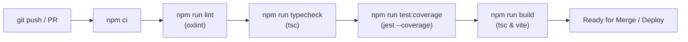

# Testing Strategy & CI/CD Reliability

## 1. Overview & Testing Pyramid

The **Manufacturing Digital Operations System** employs a layered automated testing architecture designed to guarantee transaction integrity, authorization enforcement, and business invariant compliance across manufacturing lifecycles.

```
       / \
      / E2E \       End-to-End Workflow & Business Simulations
     /-------\
    /   API   \     Controller, Route & Invariant Integration Tests
   /-----------\
  /    Unit     \   Schema, Domain Logic & Utility Tests
 /---------------\
```

1. **Unit & Invariant Layer**:
   - Zod request schemas and boundary validation (`src/schemas/*`).
   - Domain unit converters and lookup logic (`src/constants/uom.ts`, `src/uom.test.ts`).
   - Configuration and startup sanity checks (`src/config/env.ts`).
2. **API & Integration Layer**:
   - Supertest HTTP route tests covering authentication, RBAC boundaries, validation rejections, conflict handling (409), not-found paths (404), and database transactions.
   - Comprehensive mock transaction builders simulating atomic Knex operations.
3. **End-to-End Workflow Layer**:
   - Multi-step business pipeline simulations (`src/workflow.e2e.test.ts`).
   - Inventory double-booking and reservation integrity tests (`src/inventory.integrity.test.ts`).
   - Comprehensive audit trail traceability tests (`src/audit.traceability.test.ts`).

---

## 2. Test Suites Inventory (18 Suites, 212 Tests)

| Test Suite | File | Focus & Coverage |
| :--- | :--- | :--- |
| **Workflow E2E** | `src/workflow.e2e.test.ts` | Multi-step procurement → production → QC → stock cycle |
| **Inventory Integrity** | `src/inventory.integrity.test.ts` | Double-receipt prevention, negative stock protection, reservation |
| **Audit Traceability** | `src/audit.traceability.test.ts` | Immutable event logging across PR, PO, MO, QC, and Material Master |
| **RBAC Authorization** | `src/rbac.authorization.test.ts` | Role boundaries (Admin, Purchasing, Warehouse, Production, QC) |
| **Security & Reliability** | `src/security.reliability.test.ts` | DoS size limits, CORS, token claims, SoD self-approval prevention |
| **Edge Cases & Failure** | `src/edge.cases.test.ts` | Negative inputs, invalid transitions, empty bodies, concurrency |
| **Auth & RBAC** | `src/auth.test.ts` | Password verification, JWT tokens, demo user seeding, env safety |
| **Procurement API** | `src/procurement.test.ts` | PR creation, manager approval, PO creation & retrieval, GR receipt |
| **Material Master** | `src/material.test.ts` | SKU uniqueness, canonical units, inactive filtering, UUID params |
| **Product Master** | `src/product.test.ts` | Product catalog, SKU conflict handling, role gating |
| **Supplier Master** | `src/supplier.test.ts` | Duplicate checks, contact updates, inactive supplier flags |
| **Quality Control** | `src/quality.test.ts` | Defect balance validation, inspection details, pending records |
| **Production Execution**| `src/production.test.ts` | BOM reservation, completion tracking, scrap recording |
| **Production Availability**| `src/production.availability.test.ts`| Stock availability check before work order release |
| **Inventory API** | `src/inventory.test.ts` | Stock queries, manual adjustments, transaction logs |
| **Dashboard Metrics** | `src/dashboard.test.ts` | Aggregated operational KPI endpoints |
| **UOM Catalog** | `src/uom.test.ts` | Canonical units, symbol matching, categorised search |
| **Application & Health**| `src/app.test.ts` | `/api/health`, 404 handler, centralized error middleware |

---

## 3. Code Coverage Baseline & Measurements

Real code coverage measured via Jest (`npm run test:coverage`):

- **Overall Lines**: **90.95%** (825 / 907 lines)
- **Statements**: **89.17%** (898 / 1007 statements)
- **Functions**: **97.84%** (136 / 139 functions)
- **Branches**: **73.94%** (298 / 403 branches)

### Service Layer Coverage (Business Logic):
- `ProductService`: **100%** Lines
- `MaterialService`: **100%** Lines
- `SupplierService`: **100%** Lines
- `QualityService`: **100%** Lines
- `DashboardService`: **100%** Lines
- `ProductionService`: **97.05%** Lines
- `ProcurementService`: **96.05%** Lines
- `InventoryService`: **95.83%** Lines
- `AuditService`: **95.83%** Lines
- `AuthService`: **88.88%** Lines
- **Overall Services Coverage**: **96.88%** Lines

### Schema & Route Coverage:
- **All 8 Zod Schema Files**: **100%** Statements, Branches, Functions, Lines
- **All 10 Express Route Files**: **100%** Statements, Branches, Functions, Lines
- **Middleware**: **89.74%** Lines (`requireAuth`, `requireRole`, `validateRequest`)

---

## 4. Quality Gates & CI Pipeline

Every pull request and push to `main` must pass all automated quality gates defined in `.github/workflows/ci.yml`:



### Quality Gate Rules:
1. **Deterministic Dependency Installation (`npm ci`)**:
   Replaces non-deterministic `npm install`. Ensures CI strictly honors `package-lock.json`.
2. **Strict Linting (`npm run lint`)**:
   Powered by Oxlint. `continue-on-error` is disabled; any lint error or syntax defect fails the build immediately.
3. **Workspace Typechecking (`npm run typecheck`)**:
   Executes `tsc --noEmit` on the backend and `tsc -b` on the frontend. Zero TypeScript compiler errors permitted.
4. **Automated Test & Coverage Execution (`npm run test:coverage`)**:
   Runs all 18 test suites in isolated Node environment with ts-jest hybrid module diagnostics suppressed. Collects LCOV and text coverage metrics.
5. **Production Build Verification (`npm run build`)**:
   Builds the backend TypeScript bundle (`tsc`) and bundles the frontend Vite application (`vite build`), ensuring zero bundle, tree-shaking, or asset packaging regressions.

---

## 5. Local Reproduction Commands

Developers can run any of the quality gates locally with identical semantics to the CI environment:

```bash
# 1. Clean reproducible dependency install
npm ci

# 2. Fast linting across workspaces
npm run lint

# 3. TypeScript validation across backend and frontend
npm run typecheck

# 4. Run full test suite with code coverage
npm run test:coverage

# 5. Run a specific test suite
npm test --workspace=backend -- src/material.test.ts

# 6. Verify production build
npm run build
```

---

## 6. Project Boundary & Simulation Scope

- **Panasonic Boundary**: This system is an independent portfolio demonstration of manufacturing execution and digital operations. It does not use or connect to any proprietary Panasonic internal systems, databases, or APIs.
- **Test Isolation**: All integration and unit tests run in memory using deterministic mock query handlers or isolated transactions. No external PostgreSQL database instance is required to execute the test suite in CI or local environments.
